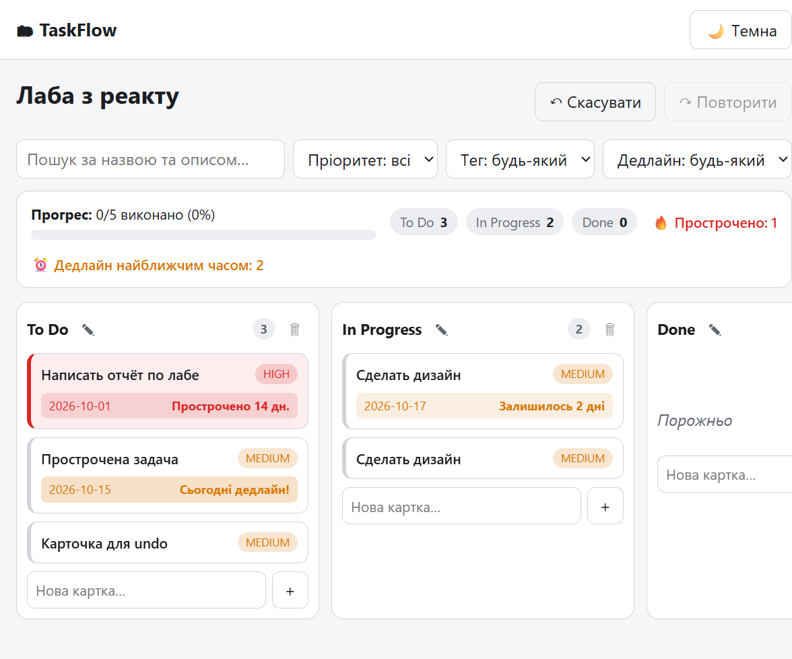
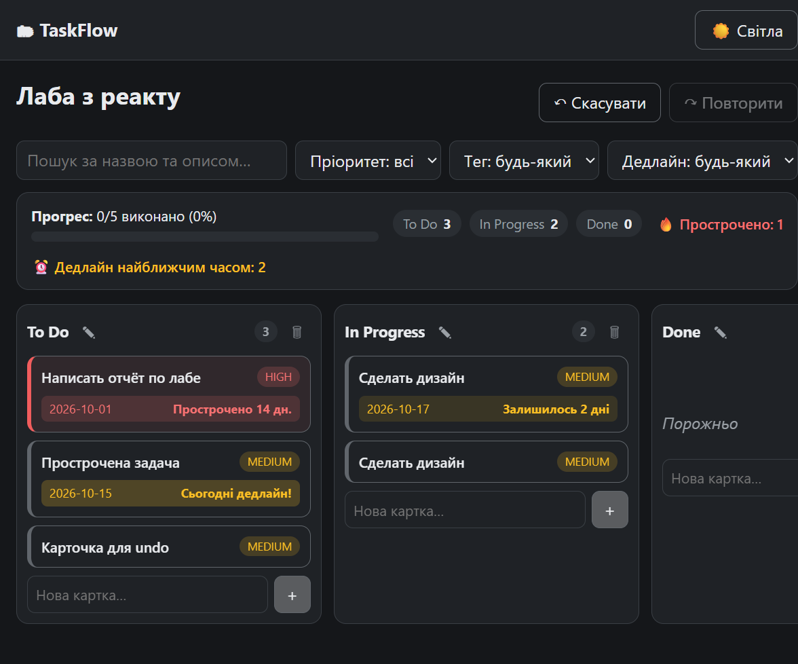

# 🗂 TaskFlow — канбан-дошка

Односторінковий застосунок (SPA) для керування задачами: дошки з колонками
«To Do / In Progress / Done», картки з пріоритетами й дедлайнами,
перетягування, фільтри в URL, undo/redo та теми оформлення.

Реалізація практичного завдання з веб-програмування на React
(варіант студента: базовий функціонал + власні покращення, див. нижче).

## ✨ Можливості

- **Дошки**: створення, перейменування, видалення, імпорт/експорт JSON.
- **Колонки**: додаються, перейменовуються (подвійний клік або кнопка ✎),
  видаляються; нова дошка отримує «To Do», «In Progress», «Done».
- **Картки**: заголовок, опис, пріоритет (low/medium/high), дедлайн, теги,
  виконавець; створення, редагування в модальному вікні, видалення.
- **Drag-and-drop** (@dnd-kit): перенос карток між колонками та зміна
  порядку, в тому числі з клавіатури (KeyboardSensor).
- **Пошук і фільтри**: текст (debounce 300 мс), пріоритет, тег, дедлайн;
  значення зберігаються в query-параметрах URL — посилання з фільтрами
  можна поділитися.
- **Undo / redo** на 50 кроків (кнопки та Ctrl+Z / Ctrl+Shift+Z).
- **Теми**: світла/темна, вибір зберігається, за замовчуванням — системна.
- **localStorage**: дані переживають перезавантаження, кривий JSON не ламає
  застосунок.
- **Адаптивність**: від 360 px, горизонтальна прокрутка колонок зі
  scroll-snap.
- **Доступність**: семантичні теги, `aria-label`/`aria-live`/`role`,
  Escape для модалок, фокус повертається на кнопку, що відкрила діалог.

### 🔎 Власні покращення 

1. **Панель статистики та прогресу дошки** (`src/components/BoardStats.jsx`):
   - прогрес-бар «виконано X%» за колонкою Done;
   - лічильники карток по кожній колонці;
   - попередження 🔥 «Прострочено: N» та ⏰ «Дедлайн найближчим часом: N».
2. **Нагадування про дедлайни** (`src/utils/filters.js` + `Card.jsx`):
   - підпис під датою: «Прострочено N дн.» / «Сьогодні дедлайн!» /
     «Залишилось N днів»;
   - колірна індикація терміновості (`data-urgency`: overdue/today/soon/ok),
     червона рамка та підсвітка прострочених карток, блимання для «сьогодні»;
   - картки-кандидати рахуються в панелі статистики.

## 📸 Скриншоти

| Світла тема | Темна тема |
| --- | --- |
|  |  |

## 🛠 Стек

React 18+ (React 19), Vite, React Router, @dnd-kit, Context API + useReducer,
CSS-змінні для тем, Vitest + React Testing Library, Prettier + oxlint.

## 🚀 Запуск

```bash
npm install     # залежності
npm run dev     # http://localhost:5173
npm test        # тести (Vitest)
npm run lint    # лінтер
npm run build   # продакшн-збірка в dist/
npm run preview # перегляд продакшн-збірки
```

## 📦 Опублікований застосунок

> Посилання додається після деплою на Vercel/Netlify:

- Vercel: імпортуйте репозиторій, збірка `npm run build`, каталог `dist`.
  Файл `vercel.json` уже додано (SPA-rewrites для клієнтських маршрутів).
- Або Netlify: каталог `dist`, додайте файл `public/_redirects` з рядком
  `/*  /index.html  200`.

## 🏗 Архітектура

```
src/
  components/  Board, Column, Card, SortableCard, CardModal, Modal,
               FilterBar, EditableTitle, BoardStats
  pages/       HomePage, BoardPage, NotFoundPage
  context/     contexts.js (контексти + хуки), BoardsContext,
               ThemeContext
  hooks/       useLocalStorage, useDebounce, useUndoRedo
  utils/       reducer (чиста логіка стану), factory (модель даних),
               filters (фільтри + дедлайни), exportImport
  test/        setup.js
  App.jsx, main.jsx, index.css
```

**Потік даних**: компонент → `dispatch` → чистий `reducer` → новий стан →
перемальовування. Зміни проходять крізь обгортку `withHistory`
(`{ past, present, future }`), тому кожна дія автоматично потрапляє в
історію undo/redo. Поточний стан (`present`) зберігається в localStorage.
Тема й фільтри в цей стан не входять: тема — окремо в localStorage,
фільтри — в адресному рядку.

**Нормалізована модель**: картки лежать у словнику `board.cards[id]`,
колонка містить лише масив `cardIds` — перенесення змінює два масиви,
редагування — один об'єкт.

## ✅ Тести

24 тести: чистий reducer (додавання/перенесення/видалення, незмінність),
історія undo/redo, фільтри та дедлайни, компоненти Modal, Card,
BoardStats.

```bash
npm test
```

## ⚠️ Обмеження

- дані зберігаються лише в localStorage (без бекенду): синхронізації
  між пристроями немає;
- імпорт/експорт працює лише через інтерфейс (кнопки на головній).
